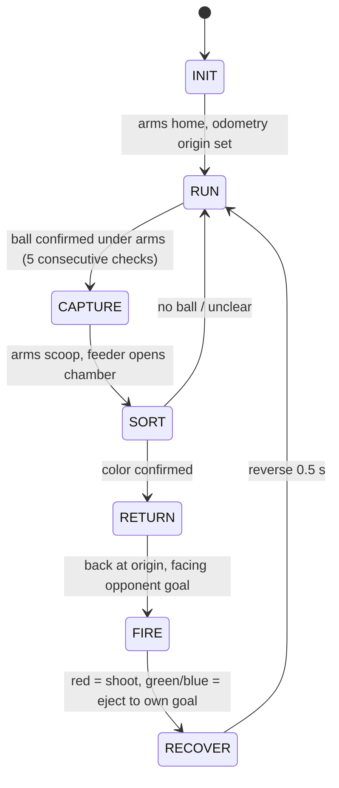

# Autonomous Ball-Collecting Rover (Pico 2 / RP2350)

Firmware for an autonomous soccer rover built for ECE 3331 (Project Lab) at Texas Tech University. The rover finds colored balls with an on-board camera, drives up to them, scoops one up, identifies its color, drives back to its starting point, and then either shoots the ball at the opponent's goal or drops it into its own goal, depending on the color.

Everything runs on a single Raspberry Pi Pico 2 (RP2350), written in C/C++ on the Pico SDK.

---

## Features

- **On-device vision:** 128×128 RGB565 frames from an Arducam Mega 3MP over SPI. A two-pass detector (grid density, then cluster centroid) finds the closest red, green or blue ball, even with several in frame.
- **Sensor fusion:** three time-of-flight sensors (two angled VL53L0X and one forward VL53L1X) handle obstacle avoidance. The forward sensor also confirms when a ball is physically under the collector arms.
- **Ball handling:** servo-driven collector arms, a TCS3200 color sensor, a rack-and-pinion feeder on a continuous-rotation servo, and a flywheel shooter.
- **Odometry and navigation:** wheel encoders track the rover's position, so after it picks up a ball it returns to its starting point and turns to face the opponent goal before firing.
- **Field-boundary protection:** soft and hard zones based on odometry that turn the rover away from the walls.
- **PC debug visualizer:** a Python/OpenCV tool that shows the camera frame and detection results streamed over USB.

---

## Hardware

| Subsystem | Part |
|---|---|
| Microcontroller | Raspberry Pi Pico 2 (RP2350) |
| Camera | Arducam Mega 3MP (SPI) |
| Distance sensors | 2× VL53L0X (front-left and front-right, angled), 1× VL53L1X (front-middle) |
| Color sensor | TCS3200 (S0/S1 hard-wired for 20% frequency scaling) |
| Collector arms | 2× MG995 servos |
| Feeder | Continuous-rotation (360°) servo driving a rack and pinion |
| Shooter | DC flywheel motor on an H-bridge |
| Drive | 4WD chassis, left/right motor channels on a custom H-bridge board |
| Encoders | Single-channel wheel encoders, 20 ticks/rev, 63.5 mm wheels, 177 mm wheelbase |
| Mode switches | Role switch (kicker/goalie) and starting-corner switch |

### Pin assignments

All GPIO assignments are in [`src/config_pins.h`](src/config_pins.h).

| Function | GPIO | Header pin |
|---|---|---|
| Arm servo B | GP0 | 1 |
| Arm servo A | GP1 | 2 |
| Encoder left / right | GP2 / GP3 | 4 / 5 |
| ToF I2C0 SDA / SCL | GP4 / GP5 | 6 / 7 |
| ToF XSHUT FL / FM / FR | GP6 / GP7 / GP8 | 9 / 10 / 11 |
| Corner switch | GP9 | 12 |
| Color sensor LED / S2 / S3 / OUT | GP10 / GP11 / GP12 / GP13 | 14 / 15 / 16 / 17 |
| Role (mode) switch | GP14 | 19 |
| Feeder servo | GP15 | 20 |
| Camera SPI0 MISO / CS / SCK / MOSI | GP16 / GP17 / GP18 / GP19 | 21 / 22 / 24 / 25 |
| Flywheel IN3 (direction) / IN4 (PWM) | GP20 / GP21 | 26 / 27 |
| Left motor IN4 | GP22 | 29 |
| Right motor IN1 | GP26 | 31 |
| Left motor IN3 | GP27 | 32 |
| Right motor IN2 | GP28 | 34 |
| Status LED | GP25 | onboard |

The ToF sensors share one I2C bus. At boot, each one is released from reset in turn and given its own address: FL = 0x30, FR = 0x31, FM = 0x32.

---

## Repository layout

```
.
├── CMakeLists.txt              # Builds the rover firmware and the camera test
├── pico_sdk_import.cmake       # Standard Pico SDK locator
├── flashandbuild.ps1           # Windows helper: build, then copy the .uf2 to the Pico
├── src/
│   ├── rover_main.cpp          # ★ Competition firmware: state machine, vision, ToF, navigation
│   ├── config_pins.h           # All pin assignments
│   ├── rover_motors.*          # Drive motor PWM
│   ├── collector_arms.*        # Arm servos
│   ├── rack_pinion.*           # Feeder servo (timed rack-and-pinion moves)
│   ├── flywheel_motors.*       # Flywheel shooter
│   ├── color_sensor.*          # TCS3200 driver and color classification
│   ├── ball_handler.*          # Identify → fire / eject sequence
│   ├── wheel_encoder.*         # Encoder ISRs and odometry
│   ├── field_boundary.h        # Wall-avoidance zones, role/corner switches
│   ├── button.*                # Start/E-stop button (stub; not wired)
│   ├── VL53L0X.* / VL53L1X.*   # Pololu ToF drivers
│   ├── Wire.h / Arduino.h      # Minimal Arduino shims so the Pololu drivers run on the Pico SDK
│   └── camera_blob_test.cpp    # Stand-alone camera test (phase1b_blob target)
├── tools/
│   └── vision_visualizer.py    # PC viewer for the camera test
├── archive/                    # Earlier phases and bring-up programs (not built)
├── libs/
│   ├── Arducam_Mega/           # Arducam Mega camera library
│   └── VL53L1X-C-API-Pico/     # VL53L1X C API (used by archived Phase 2/3 programs)
└── third_party_licenses/       # Licenses for the Pololu drivers
```

The project was built in phases (camera, then ToF sensors, then fusion, then full integration). The earlier stages are in [`archive/`](archive/), and its README describes each one.

---

## Building

### Prerequisites

- Raspberry Pi **Pico SDK 2.x**, including its submodules (builds with 2.3.1)
- `arm-none-eabi-gcc` toolchain
- CMake ≥ 3.13 and Ninja or Make

The VS Code Raspberry Pi Pico extension installs all of these for you.

### Build

```bash
export PICO_SDK_PATH=/path/to/pico-sdk   # or pass -DPICO_SDK_PATH=... to cmake

mkdir build && cd build
cmake ..
cmake --build . -j
```

If you don't have the SDK installed, configure with `-DPICO_SDK_FETCH_FROM_GIT=on` and CMake downloads it.

This produces two firmware images:

| Target | Output | Purpose |
|---|---|---|
| `projectlab_rover` | `build/projectlab_rover.uf2` | Full competition firmware |
| `phase1b_blob` | `build/phase1b_blob.uf2` | Camera-only blob-detection test that streams frames to the PC visualizer |

### Flashing

1. Hold **BOOTSEL** on the Pico 2 and plug it in over USB. It mounts as a drive named `RP2350`.
2. Copy the `.uf2` file onto that drive. The Pico reboots and runs it.

On Windows, `flashandbuild.ps1` does the build and the copy:

```powershell
.\flashandbuild.ps1                  # builds and flashes projectlab_rover
.\flashandbuild.ps1 -Target phase1b_blob
```

### Serial output

The firmware prints status over USB serial (115200 baud). At boot it waits up to 3 seconds for a USB connection, then carries on, so it also runs from battery with nothing plugged in.

---

## How it works

### State machine



| State | What happens |
|---|---|
| **INIT** | Sweeps the arms to the home position and zeroes the encoders. The rover's starting position becomes the origin (0, 0), facing 0°. |
| **RUN** | Main loop, about every 30 ms: read the ToF sensors, grab a camera frame (every third loop, or every loop while searching), update odometry, compute a drive command, and apply boundary corrections. |
| **CAPTURE** | Stops, lowers the arms onto the ball, raises them to drop it into the funnel, and opens the feeder chamber. |
| **SORT** | Reads the TCS3200 until four consecutive reads agree on a color, or gives up after eight empty reads. |
| **RETURN** | Turns toward the origin, drives back using encoder-trimmed straight-line control, then turns to face 0°. |
| **FIRE** | **Red:** spins up the flywheel, and the feeder pushes the ball into it, shooting toward the opponent goal. **Green/blue:** the feeder pushes the ball out the back into the rover's own goal. |
| **RECOVER** | Backs up briefly, then returns to RUN. |

### Drive behavior in RUN

Rules are checked in priority order:

1. **Front blocked:** the forward ToF sees something under 85 mm that isn't a ball in the capture zone. The rover reverses and steers toward the more open side.
2. **Side danger:** an angled ToF sensor sees something under 85 mm. The rover reverses away from it.
3. **Approach:** the ball is large in frame. The rover steers on the camera's x-offset and slows in steps as the forward ToF distance approaches the capture window.
4. **Track:** the ball is small or far away. The rover drives at higher speed while steering toward it.
5. **Search:** the ball is lost. The rover coasts toward the last known direction, then spins in place to scan. After several spin cycles it drives forward briefly to reposition.

**Capture condition:** the forward ToF reads 108–148 mm, both angled sensors read over 190 mm (so the object isn't another rover or a wall), and the camera is tracking a ball. This must hold for 5 loops in a row.

### Vision pipeline

1. Capture a 128×128 RGB565 frame and classify each pixel as ball-colored (red, green or blue dominant, with thresholds tuned under the lab lighting).
2. **Pass 1:** count colored pixels in a 16×16 grid of 8×8 cells. The densest cell is taken as the closest ball. Cells in the top 40% of the frame are ignored as background.
3. **Pass 2:** collect colored pixels within a 20 px radius of that cell. Reject the result if the bounding box is too elongated (aspect ratio > 2.5) or too sparse (fill < 35%).
4. Output the normalized target position (−1…+1), its pixel count (used as a distance proxy), and its bounding box.

Color identification itself is left to the TCS3200 once the ball is on board.

### Odometry

Each encoder interrupt adds or subtracts a tick depending on the commanded motor direction. Pose is computed with standard differential-drive dead reckoning: about 9.97 mm per tick, with a 177 mm wheelbase.

---

## Camera debug visualizer

Flash `phase1b_blob.uf2`, then run:

```bash
pip install pyserial numpy opencv-python
python tools/vision_visualizer.py --port COM4 --mode rgb     # use your Pico's serial port
```

The window shows the live camera frame with the detected blob and its bounding box drawn on top.

---

## Tuning

Most behavior is controlled by constants at the top of each module:

| Constant | File | Purpose |
|---|---|---|
| `STOP_DISTANCE_MM`, `SLOW_DISTANCE_MM` | `rover_main.cpp` | ToF obstacle zones |
| `FM_CAPTURE_MIN_MM`, `FM_CAPTURE_MAX_MM` | `rover_main.cpp` | Capture window |
| `rgb565_is_ball_color()` thresholds | `rover_main.cpp` | Pixel color classification |
| `NAV_*` constants | `rover_main.cpp` | Return-to-origin speeds, tolerances and timeouts |
| `CONFIRM_READS`, `EMPTY_LIMIT`, `MAX_READS` | `ball_handler.cpp` | Color confirmation |
| `ARMS_ROM_MIN/MAX`, `ARM_A_TRIM_*` | `collector_arms.h` | Arm travel and trim |
| `FEEDER_OPEN_MS`, `FEEDER_EJECT_MS` | `rack_pinion.h` | Feeder travel timing |
| `CLEAR_PRESENT_MAX`, `DOMINANT_RATIO`, `MIN_ABS_GAP` | `color_sensor.cpp` | Color classification |
| `WHEEL_DIAM_MM`, `WHEELBASE_MM`, `TICKS_PER_REV` | `wheel_encoder.h` | Odometry geometry |

---

## Known limitations

- The start/E-stop button is stubbed out (`button.cpp`), so the rover goes straight from power-on into INIT and RUN.
- The feeder position is open-loop (timed servo runs), so its travel depends on battery voltage.
- Odometry uses single-channel encoders at 20 ticks/rev, so position drifts over a long match.
- The corner switch is read and reported, but the rover always returns to the spot where it was placed rather than to a corner-specific position.

---

## Team

ECE 3331 · Group 2

- **Nicholas:** vision and firmware
- **Finn:** mechanical and motor systems; original MicroPython encoder and color-sensor logic
- **Guyton:** electronics and shooting system

---

## License

The project code is released under the [MIT License](LICENSE).

Third-party code included in this repository keeps its own license:

| Component | Source | License |
|---|---|---|
| Arducam Mega library (`libs/Arducam_Mega`) | Arducam | MIT |
| VL53L1X C API for Pico (`libs/VL53L1X-C-API-Pico`) | Alex Mous | MIT |
| VL53L0X / VL53L1X drivers (`src/VL53L0X.*`, `src/VL53L1X.*`) | [Pololu](https://github.com/pololu), based on ST's API | MIT-style + ST BSD (see `third_party_licenses/`) |
| `pico_sdk_import.cmake` | Raspberry Pi Ltd | BSD-3-Clause |
